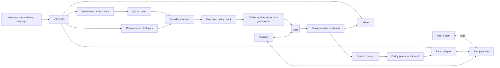

# V3ST technical design

Nov 16, 2026 · @Someone · Replaces the Nov 10 "naira ramps and payouts" design

## Summary

V3ST lets a Nigerian user fund with naira, hold fractional tokenized stocks, earn from them, and get paid to their bank account. It is built for the [Base Stocks Maxxing programme](https://www.base.org/stocksmaxxing) (submission 5 December 2026). Africa is the expansion direction; Nigeria and NGN come first.

The product has two halves, and the user sees only one of them:

- **Fiat rails** move naira between the user's bank and a licensed ramp partner. This is how money gets in and out.
- **The onchain layer** buys stock tokens on Base, puts them to work, and collects what they earn. This is where the profit comes from.

The user sees naira, shares and earnings. They never see a wallet, a seed phrase, a token approval, a network picker or a gas fee. V3ST creates the account, signs every transaction inside limits the user agreed to, and pays the gas.

## Status

Everything is beta. No real money moves anywhere in the system today.

| Area | State on Nov 16, 2026 |
| --- | --- |
| Fiat rails backend | Built. Yellow Card runs in sandbox or simulated mode; Paycrest is simulated only |
| Onchain backend | Built against a local test chain. All six stock providers are labelled local replicas; no real provider is called |
| Ledger, jobs, reconciliation, operator controls | Built |
| Landing page | Built, with a browser-only demo that calls no API |
| Customer app (sign-up, fund, buy, portfolio, earnings, withdraw) | Not built. The API exists; no screens use it |
| Real provider integration | Not built. See [Environments and the path to real providers](#environments-and-the-path-to-real-providers) |
| Privy wallets | Not integrated. A local test signer and test account stand in for it |

Detailed records: the [onchain specification](docs/superpowers/specs/2026-11-14-v3st-onchain-stocks-and-income-design.md), the [provider decision record](docs/decisions/onchain-providers.md), the [API reference](docs/api/onchain-investments.md) and the [implementation review](docs/implementation-review.md). Where this document and the Nov 14 specification disagree on onchain behaviour, the specification's rules hold until this design's open decisions are settled.

## Architecture



Naira moves only between the user's bank and the ramp partner. USDC moves only between the treasury, user accounts and trading venues on Base. The backend connects the two and records everything in one ledger.

| Component | Responsibility |
| --- | --- |
| Web app | Shows naira, shares and earnings. Holds no keys and calls only the V3ST API |
| Ramp adapter | One interface over Yellow Card and Paycrest: quote, collect, pay out, verify webhooks |
| Order orchestrator | State machine that moves each deposit and payout through its steps and retries safely |
| Ledger | Double-entry record of every naira, USD, USDC and stock-token movement |
| Investments and consent | Turns "buy ₦20,000 of this stock" into a bounded, revocable authorization and a quote |
| Quote router | Picks the provider for each order and enforces slippage and price-impact limits |
| Provider adapters | One adapter per stock provider, each declaring what it can do: spot trades, liquidity, distributions |
| Execution policy check | Decodes every prepared transaction and rejects anything outside the accepted quote |
| Wallet service | One onchain account per user, a policy-limited server signer, and sponsored gas |
| Finality and reconciliation | Waits for confirmations, reads what actually moved, and compares chain balances with the ledger |
| Income strategies | Opt-in positions that can earn fees or rewards, each with its own disclosed risks |
| Reward receipts | Evidence of each reward actually received, by source, before it can be paid out |
| Treasury | USDC on Base plus the USD float at the ramp partner, kept in balance by a rebalancer |
| Worker | Runs orders, onchain operations, the Thursday harvest and the Friday payout batch |

## Fiat rails: providers

Use a licensed ramp partner's API for every naira movement, and keep a pre-funded USD float with that partner so deposits and payouts settle in seconds instead of waiting on chain. Yellow Card is the primary partner and Paycrest the secondary. V3ST never touches naira itself.

| Provider | Role | Naira in | Naira out | Chains | Published NGN fees | Licence position |
| --- | --- | --- | --- | --- | --- | --- |
| [Yellow Card Payments API](https://docs.yellowcard.engineering/docs/getting-started-1) | Primary | Receive request returns a bank account number for the customer to pay into | Send request pays a bank account from our USD float | Stablecoin sends across 30+ blockchains, including Ethereum and Solana | Pay-in 1% under ₦100,000 (min ₦55), 0.5% above (min ₦1,350). Payout flat ₦100 ([fee schedule](https://help.yellowcard.io/article/1008-supported-payment-methods-and-associated-fees-for-yellowcards-paymentapi)) | Conditional SEC approval in principle, September 2026. CBN authorisation still needed |
| [Paycrest Sender API](https://docs.paycrest.io/implementation-guides/sender-api-integration) | Secondary | On-ramp order returns a virtual bank account and releases stablecoins on chain | Off-ramp order returns a receive address and pays the bank account once stablecoins arrive | Base and Solana | Not listed here | Provider-node licence cover in Nigeria unconfirmed |
| [Busha Business API](https://busha.io/business) | Alternative | Quote with a temporary bank account as pay-in | Quote with bank transfer as pay-out | Not stated on the page opened | Not published | SEC approval since August 2024. Needs CBN authorisation and ₦1bn extra capital |
| [Blockradar](https://docs.blockradar.co/en/introduction/faq.md) | Optional single-vendor route | Reusable NGN virtual accounts that convert deposits to stablecoins | Withdraw Fiat pays NGN bank accounts | Base, Solana, Ethereum and 13 others | Set per plan | Not confirmed |

Why this choice:

- **The float model fits a weekly payout.** A completed deposit credits our USD float, and a payout debits it. Deposits therefore fund payouts, and only the net difference moves on chain.
- **The flat ₦100 payout fee suits small earnings.** A ₦5,000 payout costs 2%. It also sets a floor: paying out ₦500 would lose 20% to the fee.
- **Two partners remove a single point of failure.** Paycrest needs no float and takes orders from $0.50, but it runs on mainnet only and delivers USDC to the user's account, which carries the retail-stablecoin risk described under Compliance. That is why it is secondary and simulated-only in beta.
- **Yellow Card has a sandbox** at `https://sandbox.api.yellowcard.io/business`, where test account numbers simulate success or failure.

Partner licence positions come from [a summary of the CBN rules](https://afroconomist.substack.com/p/usdt-in-nigeria-will-never-be-the) issued on 5 November 2026.

## Onchain layer: providers

Stock tokens on Base are issued under Base's B20 standard and listed in Base's [Tokenized Stocks API](https://docs.base.org/sdks/tokenized-stocks/overview), which is free, read-only and needs no key. That API gives identity, multipliers and reference prices. It does not trade. Trading, liquidity and rewards come from the six programme partners, and they are not six interchangeable brokers: each has a different job.

| Provider | Role in V3ST | Public surface (checked Nov 16, 2026) | Testnet |
| --- | --- | --- | --- |
| [o1 Exchange](https://docs.o1.exchange/api/trading.md) | Default route for buying and selling stock tokens | Trading API builds unsigned transactions that our signer signs. A separate launchpad API covers stock-paired launch tokens, with fees and holder dividends paid in the paired stock token | None documented. Base mainnet only |
| [Hydrex](https://github.com/hydrexfi/hydrex-sdk) | Liquidity venue and the first income strategy: provide stock/USDC liquidity and earn trading fees | `@hydrexfi/hydrex-sdk` for swaps, adding and removing liquidity, and collecting fees. Gauge rewards are claimed separately. Hydropump launches lock liquidity permanently | Base Sepolia: the SDK lists a pool deployer. No stock pool is documented on either network |
| [Bankr](https://docs.bankr.bot/wallet-api/swap/) | Alternative execution route using a Bankr-managed wallet per user | Partner API provisions one wallet per user; swap API quotes and executes. Needs an approved partner organisation. Stock trades need a location check, and Nigeria is not named either way | None documented |
| [Stonks Exchange](https://www.thestonks.exchange/about) | Experimental reward source: launch tokens priced in a stock, with creator fees optionally paid to holders as stock | Published Base mainnet contracts (launcher, fee locker, router, quoter). No API or SDK | None documented |
| [BaseStonk](https://basestonk.io/) | Experimental discovery only | Stock-paired launches on Uniswap v4 hooks. No docs, API or contract addresses published | None documented |
| [Feel.cash](https://feel.cash/launchpad) | Experimental reward source: stock rewards to holders of specific launch tokens | Product pages only. No docs, API or launchpad contracts published | None documented |

These are documentation readings, not integration tests. The Hydrex docs site could not be loaded, so its row comes from the SDK's README and has not been checked on chain.

**Order of use.** A normal purchase goes through the default spot route. Bankr is a separate custody profile and is never chosen automatically for an account V3ST controls. Stock-paired launch tokens (o1 launchpad, Stonks, BaseStonk, Feel.cash) are speculative memecoins priced in a stock, not stocks; they are available only through explicitly labelled experimental paths and never as a default allocation.

### How the crypto stays hidden

| What a crypto app asks | What V3ST does instead |
| --- | --- |
| Connect or create a wallet | An onchain account is created for the user at sign-up. The design target is a Privy embedded wallet; the beta uses a local test account |
| Sign each transaction | The user confirms an investment in naira once. That creates a stored authorization with a value cap, fee cap, slippage cap and expiry. A server signer acts only inside it, and the user can revoke it |
| Approve tokens | Approvals are part of the prepared transaction batch and are limited to the exact amount |
| Hold ETH for gas | A relayer pays gas from a sponsor budget with daily and per-operation caps. Gas is a V3ST operating cost. A sponsorship failure pauses the operation; it never asks the user to buy ETH |
| Choose a network or venue | The quote router chooses. The API accepts a quote ID, never a provider, chain, recipient or calldata |

**Privy as the design target.** Privy was chosen for login by phone, email or passkey, embedded wallets created before first login, server signers with policies, sponsored gas, treasury wallets with signer quorums, and key export so users can leave with their assets. None of this is wired in yet, and the combination of Privy, B20 stock tokens and gas sponsorship has not been tested end to end.

### Execution pipeline

Every onchain action, whether a buy, a sell, a strategy entry or a reward claim, follows the same path:

1. **Quote.** The adapter returns expected and minimum output, all fees, and an expiry of at most 30 seconds. The quote is stored and bound to the user, assets, amounts and account.
2. **Consent.** The user confirms. A one-time authorization is tied to that quote; a standing authorization covers named background actions (claim, reward conversion, reinvest, sale for withdrawal) under naira caps for at most 30 days.
3. **Prepare.** The adapter builds the transactions. Provider-supplied calldata is treated as untrusted.
4. **Policy check.** Each call is decoded and checked for chain, target contract, spender, recipient, assets, amounts, minimum output and deadline. Unknown functions, unlimited approvals and arbitrary nested calls are rejected.
5. **Sign and broadcast.** The exact signed payload is stored before broadcast. Account nonces and relayer nonces are tracked separately so a crash cannot double-send.
6. **Finality.** The operation waits for two confirmations. Fills are read from that transaction's own transfer logs, not from balance changes.
7. **Post.** The ledger records what actually moved. Unused cash is released. A timeout is recorded as unknown and reconciled against the chain; it is never resent through a different route.

A partial fill is allowed only if the accepted quote said so, and must keep the quoted rate. A failed buy leaves the user's cash intact.

### Stock tokens are not ordinary tokens

- **One token is not always one share.** Each B20 stock has a multiplier that changes on splits and dividends. Share-equivalent quantity is `raw balance × multiplier`, and the raw balance never changes on a split.
- **Dividends do not arrive as cash.** They raise the multiplier. So "weekly dividend for every stock" is not something the product can promise.
- **The reference price is not a tradeable price.** It is a Chainlink-based value that stops updating outside market hours. A reference older than 60 seconds blocks new automated trades, and stale values are shown as unavailable rather than current.
- **Tokens can be restricted.** Issuers can block addresses or pause functions. Coinbase's stock tokens are offered only in eligible jurisdictions outside the United States, and integrators must apply the restrictions themselves.
- **They are built into the chain.** B20 stocks are native to Base rather than separately deployed contracts, which may prevent a standard local fork from running them. This is untested.

Token quantities use exact 256-bit integers. Cash stays in kobo and micro-dollars. Nothing uses floating point.

## How users earn

"Extra income" is the product's goal, not a guaranteed return. Each source below is separate, and the app must say which one applies before the user commits.

| Source | What it means for the user | Provider | How it is recorded |
| --- | --- | --- | --- |
| Stock price and FX change | The investment's naira value rises or falls | Any | Unrealized until sold. Not cash and not payable |
| Selling shares | Proceeds are returned principal plus a gain or loss | Spot route | Cost basis reduced first-in-first-out; only the gain is profit |
| Liquidity fees | A share of trading fees from a stock/USDC pool the user chose to join | Hydrex | Fees recorded separately from returned principal and from any price loss in the pool |
| Holder stock rewards | Rewards paid in stock to holders of a specific launch token | o1 launchpad, Stonks, Feel.cash | Receipt per claim. Owning only the underlying stock does not qualify |
| Incentive tokens and options | A conditional benefit such as Hydrex gauge rewards | Hydrex | Not cash until claimed and converted |

Rules that follow from this:

- **Buying a stock never opts the user into anything else.** Liquidity provision and launch-token positions are separate choices with separate consent.
- **Income exists only once it is received.** A reward becomes payable when its claim is confirmed on chain, converted to USDC if it arrived as another asset, and recognized once. Estimates are shown as estimates.
- **A strategy can earn nothing and can lose principal.** The default liquidity strategy is capped at 20% of the user's investment value and $100 equivalent per transaction in beta. This is a demo risk limit, not advice.
- **Holding a stock or idle cash pays no automatic income.**
- **V3ST's own fee is a separate, disclosed ledger line.** It is never mixed into user income. The beta margin is zero.

**What is real today.** In the beta, every source above is produced by local replica contracts with fixture values. They prove the orchestration and accounting. They are not evidence that a real Hydrex stock pool exists, that any provider pays a given rate, or that the product is profitable after trading fees, payout fees, FX and gas.

## On-ramp flow: naira to shares

A deposit becomes shares in one background sequence. The user makes one bank transfer and signs nothing.

1. **User picks a stock and an amount.** The app requests an investment quote in naira and the user confirms it, which stores the authorization.
2. **Backend requests a ramp quote.** The ramp adapter fetches the partner's channel and rate, then submits a receive request. Submitting locks the exchange rate.
3. **App shows bank details.** The partner returns a bank account number. The app displays it with the exact amount and an expiry timer.
4. **User pays from their own bank app.** The sending account name must match the verified user. Mismatches are refunded through the partner's refund call.
5. **Partner confirms.** A signed webhook moves the collection to complete, and the partner credits our USD float.
6. **Ledger credits the user.** The backend verifies the webhook signature, re-fetches the transaction by ID, and posts the USD value as a pending claim.
7. **Treasury funds the account.** The treasury sends the same USDC amount to the user's onchain account. Gas is sponsored. Once confirmed, the pending claim becomes available cash, exactly once.
8. **Router buys the stock.** If the accepted investment is still valid, the execution pipeline swaps USDC for the stock token. If it has expired, the cash stays available and the app asks the user to confirm a fresh quote.
9. **App updates.** The user sees shares and a naira value.

Steps 6 to 8 do not wait for our float to be withdrawn to chain. The treasury fronts the USDC, and a scheduled job rebalances float and treasury.

**Target time:** under 2 minutes from bank transfer to shares, dominated by the bank transfer itself. This is a target; no real partner latency has been measured.

**Returning users.** Yellow Card's virtual accounts cover NGN. Each user could get one permanent account number, so steps 2 to 4 collapse into "transfer any amount to your V3ST account number".

## Off-ramp and Friday payout flow

Payouts land in the user's own Nigerian bank account by bank transfer, paid from our USD float at the partner.

**One-time setup.** The user adds a bank account. The backend resolves the account name through the partner and accepts it only if it matches the verified user.

**Withdrawal on request**

1. User taps Withdraw and enters a naira amount, or chooses to sell shares.
2. Backend quotes the naira amount and fee, and the app shows "You receive ₦X".
3. If shares are being sold, the execution pipeline swaps the stock token to USDC.
4. The backend moves the USDC from the user's account to the treasury. Gas is sponsored.
5. The ledger records the debit, then the ramp adapter submits a send request with the bank details.
6. The partner debits our USD float and pays the bank account.
7. A complete webhook marks the payout paid. The app shows the bank reference.

**Friday payout of earnings.** All times are Africa/Lagos.

| When | Job | What it does |
| --- | --- | --- |
| Thursday 22:00 | Harvest | Claims fees and distributions for each active strategy position. No yield is computed from holdings |
| Thursday 23:00 | Float pre-check | Compares the batch total with the float and tops it up from the treasury if short |
| Friday 08:00–23:00, hourly | Payout batch | Pays out or reinvests received income, oldest first, one allocation per receipt per week |

| Rule | Value | Reason |
| --- | --- | --- |
| Minimum payout | ₦2,000 gross | The flat ₦100 fee is 5% at this size and grows quickly below it |
| Who pays the payout fee | User, shown before confirming | Keeps small payouts honest about cost |
| Default for earnings | User picks once: pay out or reinvest | Reinvesting avoids the payout fee |
| Destination | Only the user's own verified account | Name match is a compliance control |
| Below the minimum | Rolls over to the next Friday, shown as pending | Nothing is lost |

Friday is a payout schedule. It promises neither income every Friday nor a bank arrival time.

## Ledger and data model

A double-entry ledger in Postgres is the source of truth for money. Partner dashboards and chain balances are reconciled against it, never the other way round.

| Group | Tables | Holds |
| --- | --- | --- |
| Identity | `User`, `Session`, `BankAccount` | Verification state and the verified payout destination |
| Accounts | `Wallet`, `CustodyProfile`, `TreasuryWallet` | One onchain account per user, who controls it, and the treasury |
| Fiat orders | `RampOrder`, `OrderTransition`, `WithdrawalQuote`, `WebhookEvent` | Every deposit and payout, its state history and raw partner events |
| Ledger | `LedgerAccount`, `LedgerJournal`, `LedgerEntry` | Balanced, append-only entries in kobo, micro-dollars and raw token units |
| Catalog | `Stock`, `StockAction`, `Strategy` | Stock identity by chain and address, corporate actions, versioned strategies |
| Investing | `InvestmentAuthorization`, `InvestmentQuote`, `Investment`, `PositionLot` | Consent, accepted terms, fills and cost-basis lots |
| Execution | `OnchainOperation`, `OnchainStep`, `SignedPayload`, `ChainObservation`, `SponsorBudget`, `OnchainNetwork` | Each operation's steps, signed bytes, receipts, gas spend and network identity |
| Income | `StrategyPosition`, `StrategyQuote`, `RewardReceipt`, `EarningAllocation`, `Earning` | Positions, each reward received, and its single payout or reinvest allocation |
| Operations | `Job`, `ScheduleRun`, `ReconciliationRun`, `OperationalControl`, `OperationalAlert` | Background work, reconciliation results, pause switches and alerts |

**Order states**

- Deposit: `created` → `awaiting_transfer` → `received` → `funded` → `settled`. Side exits: `expired`, `refunded`, `failed`.
- Payout: `created` → `funds_collected` → `submitted` → `paid`. Side exits: `reversed`, `failed`.

**Rules**

- Every state change is one database transaction that writes the row and its ledger entries together.
- Every financial write carries an idempotency key. Retried calls and replayed webhooks return the existing result.
- A stock is identified by chain and contract address, never by ticker alone.
- A reward receipt is unique by network, source, transaction, log index and beneficiary, so the same reward cannot be counted twice.
- Quotes, authorizations and operations are immutable once stored. Corrections are new compensating entries.
- User-facing naira values are computed at read time from USD amounts and the current rate. They are never stored as balances.

## API surface

The web app talks only to the V3ST API under `/api/v1`. Provider calls sit behind adapter interfaces, so swapping a provider changes no app code. Full request and response shapes are in the [API reference](docs/api/onchain-investments.md).

| Area | Endpoints |
| --- | --- |
| Account | `auth/session`, `auth/logout`, `me`, `identity/verification`, `banks`, `bank-accounts` |
| Funding | `POST deposits`, `GET deposits/{id}`, `GET rates/ngn` |
| Catalog | `GET stocks`, `GET stocks/{id}`, `GET strategies`, `GET strategies/{id}` |
| Investing | `POST investments/quote`, `POST investments`, `GET investments/{id}`, `investment-authorizations` |
| Income | `POST strategy-quotes`, `POST strategy-operations`, `GET strategy-positions`, `POST reward-receipts/{id}/convert` |
| Holdings and earnings | `GET portfolio`, `GET earnings`, `PUT earnings/preference` |
| Withdrawals | `POST withdrawals/quote`, `POST withdrawals`, `GET withdrawals/{id}` |
| Live updates | `GET events` (server-sent events, resumable) |
| Webhooks | `webhooks/yellowcard`, `webhooks/paycrest` |
| Operators | `ops/status`, `ops/integrations`, `ops/onchain-operations`, `ops/controls`, retries, refunds and approvals |

No response contains a signing payload, private key or provider instruction. Every financial response states that it is beta, which network executed it, and whether the provider was a local replica or a verified provider testnet.

**Adapter interfaces**

```ts
interface RampProvider {
  quote(dir: 'in' | 'out', ngnAmount: bigint): Promise<Quote>;
  createCollection(q: Quote, customer: Customer): Promise<Collection>; // returns bank details
  refundCollection(ref: string): Promise<void>;
  resolveBankAccount(bankCode: string, account: string): Promise<string>; // account name
  createPayout(q: Quote, dest: BankAccount, key: string): Promise<Payout>;
  getTransaction(ref: string): Promise<ProviderTx>;
  floatBalance(): Promise<bigint>; // micro-USD
  verifyWebhook(headers: Headers, body: string): boolean;
}

interface SpotAdapter {
  readonly capabilities: ProviderCapabilities;
  quote(input: QuoteRequest): Promise<ExecutionQuote>;
  prepare(quote: ExecutionQuote, operationId: string): Promise<ExecutionPlan>;
}

interface StrategyAdapter {
  readonly capabilities: ProviderCapabilities;
  quote(input: StrategyRequest): Promise<StrategyQuote>; // enter, claim or exit
  prepare(quote: StrategyQuote, operationId: string): Promise<StrategyPlan>;
}
```

Adapters only quote and prepare. They never sign. Signing belongs to the wallet service, after the policy check.

**Mapping to Yellow Card** (from its [getting started guide](https://docs.yellowcard.engineering/docs/getting-started-1))

| Adapter call | Yellow Card step |
| --- | --- |
| `quote` | Get Channels, then Get Rates |
| `createCollection` | Submit a receive request, then accept it |
| `refundCollection` | Receive refund |
| `createPayout` | Submit a send request |
| `floatBalance` | Account balance (confirm the endpoint in the API reference) |
| Float top-up and withdrawal | Settlement: stablecoin sent to our top-up address, or paid out to our whitelisted wallet |

Every webhook is treated as a hint. The handler always re-fetches the transaction from the partner before changing state.

## FX, fees, limits and failure handling

The user always sees one naira figure that already includes the rate and every fee. Nothing is charged that was not shown on the confirmation screen.

**Rate and fees**

- The naira rate is locked when the partner accepts a receive or send request. The app shows that locked rate, not a cached one.
- A ₦20,000 deposit pays ₦200 to the partner at the published 1% rate. A ₦5,000 payout pays ₦100.
- Trading venue fees, slippage and reward conversion fees are shown in the quote, each with its source asset.
- V3ST's own margin, if any, is a separate ledger line posted to the fees account. It is not hidden in the rate.
- Network gas is paid by V3ST and booked as an operating cost.

**Float and treasury rebalancing**

- Two pools hold working capital: the USD float at the partner and the USDC treasury on Base.
- Deposits grow the float and shrink the treasury. Payouts do the reverse.
- An hourly job requests a balance payout to the treasury when the float exceeds its ceiling, and tops up from the treasury when it falls under its floor.

**Failure handling**

| Failure | Detection | Response |
| --- | --- | --- |
| User never transfers | Quote expiry timer | Order moves to `expired`. Nothing to undo |
| User sends the wrong amount | Webhook amount differs from the order | Credit the amount received at the locked rate, or refund if outside tolerance |
| Transfer from a third-party account | Sender name does not match | Refund through the partner. No credit |
| Webhook never arrives | Poller checks open orders every minute | Advance state from the fetched transaction |
| Treasury short of USDC | Balance check before funding | Order waits in `received`, alert fires, rebalancer tops up |
| Stock swap fails or slips past the limit | Transaction reverts or the quote is rejected | User keeps the cash. App offers a retry with a fresh quote |
| Quote expires before the buy | Deadline check | Cash stays available; user confirms a new quote |
| Broadcast outcome unknown | Timeout with no receipt | Operation stays under reconciliation with its original transaction. Never resent elsewhere |
| Gas sponsor exhausted | Sponsor budget check | Operation pauses with a resumable reason. The user is never asked for ETH |
| Reward claim pays nothing | Zero amount in the receipt | No income recorded. Position stays open |
| Strategy exits at a loss | Exit proceeds below principal | Loss recorded against principal; fees stay separately claimable |
| Authorization revoked | Revocation epoch | New signing stops. Work already broadcast is reconciled |
| Chain and ledger disagree | Fixed-block reconciliation | Trading and payouts pause until an operator resolves it |
| Payout rejected by the bank | Partner webhook with a failure state | Order moves to `reversed`. Funds return to the user |
| Partner outage | Health check and error rate | New orders go to the failover partner. Open orders stay with their original partner |
| Float short on Friday | Thursday pre-check | Top up before the batch. If still short, pay oldest earnings first and retry hourly |

**Limits**

- Per-user daily and monthly limits follow KYC tier and the partner's own limits, whichever is lower.
- Slippage and price impact are each capped at 1% per trade.
- Transfers worth $1,000 or more carry full sender and recipient details to meet the Travel Rule.

## Environments and the path to real providers

| Environment | Chain | Stock providers | Money |
| --- | --- | --- | --- |
| Beta today | Isolated local test chain (ID 31337), no fork | Six labelled local replicas | None. Test tokens only |
| Provider testnet (proposed) | Base Sepolia (84532) | Hydrex's real testnet contracts with a test stock token we deploy; others stay replicas; stock list and prices read from Base's live API | None |
| Mainnet pilot (proposed, needs sign-off) | Base (8453) | o1 for trades, Hydrex for liquidity, Stonks contracts for rewards, Bankr if a partner account is approved | Real, under small operator-funded caps |

The rule recorded on 14 November stands until changed: `APP_STAGE=beta` is required, mainnet chain IDs are rejected in every environment, and a real provider can be enabled only by recorded evidence plus a reviewed configuration change, never by an operator toggle.

That rule and the product's purpose now pull in opposite directions. Five of the six providers, and the stock tokens themselves, document no testnet. A real integration with them, and any real profit, is possible only on Base mainnet. Whether and when to run a capped mainnet pilot is the main open decision in this design.

BaseStonk and Feel.cash publish nothing to integrate against, so they stay replicas in every environment until they do.

## Compliance

V3ST should operate as an agent or distributor of a licensed partner, because holding, swapping or moving stablecoins in Nigeria now needs a CBN licence and ₦1bn of locked capital. This section is a design input, not legal advice. Nigerian counsel must confirm it before launch.

The points below come from [a summary of the CBN's Regulations for the Operations of Non-Security Virtual Assets](https://afroconomist.substack.com/p/usdt-in-nigeria-will-never-be-the), issued on 5 November 2026. The regulation's start date is not yet fixed, and existing operators get 180 days from that date to apply.

| Rule | Effect on this design |
| --- | --- |
| Converting naira to stablecoins as a payment service needs CBN authorisation | The partner performs every conversion. V3ST never quotes or executes naira FX itself |
| USDC and USDT are recognised only for wholesale settlement, not for retail users, until an issuer holds a Nigerian licence | Users should hold shares, not dollar balances. Deposits should buy a stock in the same sequence |
| No interest or yield for holding a stablecoin | Earnings come from stock positions and chosen strategies only. Idle cash never earns |
| Name and BVN on the naira payment must match the verified customer | Applied to all deposits and payouts as a baseline control |
| Travel Rule at $1,000 and above | Sender and recipient details attached to qualifying transfers |
| The CBN can cap or switch off naira-to-dollar stablecoin conversion in FX stress | Ramps can stop without notice. The app needs a clear "deposits paused" state and must never block selling or viewing holdings |
| Rules reach offshore firms serving people in Nigeria | Incorporating abroad does not avoid them |

**Split of responsibilities**

| Area | Partner | V3ST |
| --- | --- | --- |
| Naira collection and payout | Yes | No |
| Naira and stablecoin conversion | Yes | No |
| User identity checks | Receives KYC data with each request | Collects and verifies BVN-linked identity |
| Sanctions and fraud screening | Built into the API | Screens addresses before onchain transfers |
| Stock eligibility by jurisdiction | Issuer and provider set the rules | Applies them per user; unknown eligibility is never treated as approved |
| Records and reporting | Its own transactions | Full order, operation and ledger history per user |

**Securities side.** The stock tokens fall under the SEC, which treats digital assets as securities and requires registration or recognition for anyone offering such services in Nigeria. Whether distributing foreign-issued tokenized stocks needs its own SEC registration is the largest open legal question.

**What the user is told.** Tokenized stock exposure is not a promise of direct legal ownership, voting rights or guaranteed dividends. Launch tokens are speculative and are not claims on any company. A liquidity position is not a savings product.

## Open questions

**Onchain**

- [ ] **Mainnet pilot.** Approve or decline a capped Base mainnet pilot, and set the caps and who funds it.
- [ ] **Nigerian eligibility for stock tokens.** Confirm whether Nigeria is an eligible jurisdiction for Coinbase's stock tokens and for Bankr's location check.
- [ ] **A real stock pool on Hydrex.** Find or create a stock/USDC pool, and confirm its fee tier, depth and reward rules. Without one, the liquidity strategy has no real venue.
- [ ] **o1 for plain stock trades.** Confirm the Trading API can swap USDC for a B20 stock token on Base, and get an API token.
- [ ] **Bankr partner access.** Apply for a partner organisation, and decide whether a second custody model is worth the complexity.
- [ ] **Privy and stock tokens.** Test Privy's policies, server signers and gas sponsorship with B20 tokens, which are built into the chain rather than deployed as contracts.
- [ ] **Economics.** Model net income after trading fees, payout fees, FX, gas and losses, including the zero and loss cases.
- [ ] **Launch-token exposure.** Decide whether retail newcomers should be offered launch tokens at all.

**Fiat and legal**

- [ ] **Idle cash.** Where does money sit between a deposit and a purchase, and where do unpaid earnings sit? Options: force every deposit to buy a stock, hold idle cash as cNGN, or hold USDC and accept the retail-stablecoin risk.
- [ ] **Partner terms.** Will Yellow Card sign an agent or distributor agreement that covers a securities-linked app, and at what fees and limits?
- [ ] **Base support at Yellow Card.** Confirm Base is included for float top-ups and withdrawals.
- [ ] **Virtual accounts for NGN.** Confirm the cost and limits of one account per user, and which account name the user's bank app will show.
- [ ] **Float sizing.** Set the floor and ceiling once expected weekly volumes are known.
- [ ] **Custody view.** Confirm with counsel that neither the treasury fronting USDC nor a server signer on user accounts makes V3ST a custodian.
- [ ] **Securities registration.** Confirm what the SEC requires to distribute foreign-issued tokenized stocks to Nigerian users.
- [ ] **Privy cost.** Price the plan against at least one signed transaction per user per week.
- [ ] **Other African markets.** Decide the second country after Nigeria.

## Sources

**Programme and stock tokens**

- [Base Stocks Maxxing](https://www.base.org/stocksmaxxing)
- [Base: Tokenized Stocks API](https://docs.base.org/sdks/tokenized-stocks/overview)
- [Base: integrate tokenized stocks](https://docs.base.org/build-on-base/integrate-defi/list-tokenized-stocks)
- [Base: Vibenet](https://docs.base.org/build-on-base/test-on-vibenet)

**Stock providers**

- [o1 Exchange: Trading API](https://docs.o1.exchange/api/trading.md), [launchpad trading](https://docs.o1.exchange/launchpad/api/trading), [production contracts](https://docs.o1.exchange/launchpad/reference/production-contracts.md), [stock-paired launches](https://docs.o1.exchange/launchpad/create/stock-paired-launches.md)
- [Hydrex SDK](https://github.com/hydrexfi/hydrex-sdk), [Hydrex liquidity](https://www.hydrex.fi/liquidity)
- [Bankr: swap API](https://docs.bankr.bot/wallet-api/swap/), [wallet provisioning](https://docs.bankr.bot/partnership/wallet-provisioning/), [tokenized stocks](https://docs.bankr.bot/features/trading/tokenized-stocks)
- [Stonks Exchange: how it works](https://www.thestonks.exchange/about)
- [BaseStonk](https://basestonk.io/)
- [Feel.cash launchpad](https://feel.cash/launchpad)

**Fiat rails and wallets**

- [Yellow Card Payments API: Getting Started](https://docs.yellowcard.engineering/docs/getting-started-1), [virtual accounts](https://docs.yellowcard.engineering/docs/virtual-accounts), [fees](https://help.yellowcard.io/article/1008-supported-payment-methods-and-associated-fees-for-yellowcards-paymentapi)
- [Paycrest: Sender API integration](https://docs.paycrest.io/implementation-guides/sender-api-integration)
- [Busha Business](https://busha.io/business)
- [Blockradar FAQ](https://docs.blockradar.co/en/introduction/faq.md)
- [Privy: user wallets](https://docs.privy.io/wallets/overview/solutions/user-wallets.md), [server access](https://docs.privy.io/wallets/wallets/server-side-access), [gas sponsorship](https://docs.privy.io/wallets/gas-and-asset-management/gas/ethereum), [pricing](https://privy.io/pricing)

**Regulation**

- [The Afroconomist: the CBN's new stablecoin and crypto rules explained](https://afroconomist.substack.com/p/usdt-in-nigeria-will-never-be-the)
- [DIA Data: cNGN profile](https://www.diadata.org/map/global-stablecoins/stablecoin/cngn/)
