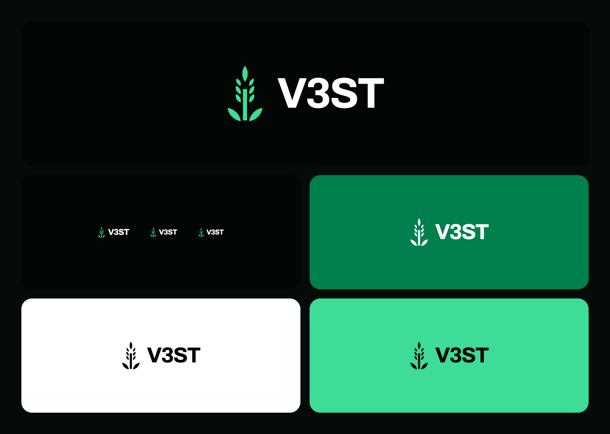
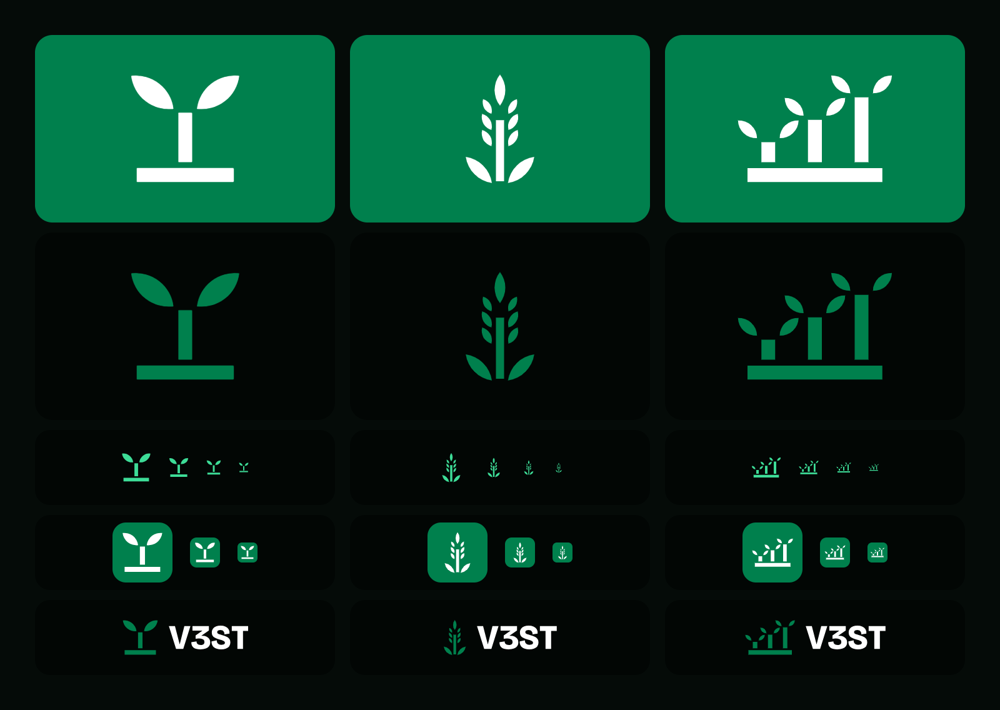

# V3ST logo

The product logo is a lockup: the grain mark beside the name *V3ST*, set the way Parcours sets its own.



- **In the product** it is `Logo` in `src/components/logo.tsx`. One font-size sizes the whole lockup: the mark is 1.35em tall and sits 0.32em from the name.
- **The name is live text**, Archivo 700 at −0.03em, so it stays selectable and screen readers read it as "V3ST". Nothing is outlined, so there is no static lockup file. Use the preview above to see it, and the mark files for anything outside the product.
- **The mark is mint** (`#3DDC97`) beside a white name on the dark ground. On signal green, white or mint, draw both in one ink (`accent={false}`).
- **The mark alone** is the favicon (`src/app/icon.svg`, mint on void). The original green artwork is [v3st-grain.svg](v3st-grain.svg). The social image sets the lockup above the headline.

## How the grain was chosen

The preview below records the three options drawn on 2026-11-20, alongside the former [V3ST wordmark](v3st-wordmark.svg).



Each option draws a plant from the brief (harvest, growth, yield) as a bare mark, with no ring. They share one construction, so they differ in idea, not in style.

| Option | Stands for | The idea | Where the V is |
| --- | --- | --- | --- |
| `v3st-sprout.svg` | Growth | A seedling breaks the ground | Its two leaves open into a V |
| `v3st-grain.svg` | Harvest | An ear of grain rises from two leaves | The leaves make a V; the kernels pair into three more, so V3 |
| `v3st-crop.svg` | Yield | Three seedlings climb like a chart | Each opens into a V; there are three |

At small sizes the sprout holds up best down to 16px. The grain thins to a sliver at 16px but reads from 24px. The crop needs 32px.

## Construction

Each mark is drawn on a 100-unit square. Each file's viewBox is cropped to the drawing.

| Part | Rule |
| --- | --- |
| Stems and ground lines | 8 wide; the grain's stem is 7 |
| Leaves and kernels | Lenses, each set by the angle at its tips (74° to 92°) |
| Gap | 3.5 between shapes. Leaves start one gap from the stem's top corner, along their own axis |

`scripts/logo.mjs` measures every pair of shapes and refuses to draw if any two come closer than 2.8; lens tips may sit a little inside the gap. Change the numbers there and run it again rather than editing the SVGs by hand:

```sh
node scripts/logo.mjs
```

The script also generates the grain favicon and the lockup preview, which loads Archivo from Google Fonts and refuses to render with a fallback face. Both this generator and `scripts/social-image.mjs` render in Playwright's Chromium. Set `LANDING_CHROMIUM_PATH` to use a specific browser binary.
