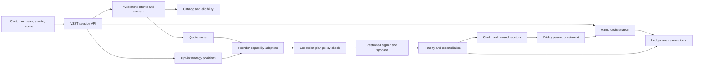

# V3ST onchain stocks and income design

Date: 2026-11-14 · Status: proposed implementation specification · Release: beta only · Scope: backend/API only

## Purpose and scope

V3ST is a Nigerian-first investing product for the [Base Stocks Maxxing programme](https://www.base.org/stocksmaxxing). A customer chooses a stock, funds with naira, sees fractional stock exposure and performance, and can withdraw eligible proceeds to their bank. Blockchain accounts, routing, transaction signing and network fees are handled by V3ST. Africa is the expansion direction; this release implements NGN and Nigeria fixtures, not unverified support for every African jurisdiction.

The [ramp design](../../../Design.md) supplies money movement. This document supplies the missing asset, execution, custody-abstraction and income layers. Implement it through the [onchain implementation plan](../plans/2026-11-14-v3st-onchain-stocks-and-income.md), alongside the earlier [beta plan](../plans/2026-11-13-v3st-naira-ramps-and-payouts.md). The present request produces documentation; it does not implement or activate integrations.

**Latest scope instruction:** the user explicitly restricted this work to backend/API and requested testnets for crypto integrations. They approved **local testnet contract replicas, clearly labelled, with real provider adapters disabled until verified** where provider testnets are unavailable. This overrides the earlier full-stack requirement and the initial proposal for database-only crypto simulations. No frontend, UI dependency, page, style or `DESIGN_SYSTEM.md` work belongs in this plan.

“Extra income” is a product objective, not an assumed return. Buying an asset can produce a gain or loss. A separate strategy can produce fees or rewards and can also lose principal. The application must explain the particular source and recipient of proceeds before an investment. Plain language must not conceal whether the customer owns stock exposure, a liquidity position, or a speculative token.

## Decisions for the proposed beta

1. Base is the first investment network. Preserve existing simulated Solana records and ramp support, but do not build new Solana, Robinhood Chain or cross-chain investment routes in this work.
2. Default investment is direct stock exposure. Buying a stock never silently opts into liquidity provision, token launching, borrowing or a rewards scheme.
3. Model an optional stock/settlement-asset liquidity strategy to demonstrate additional income. Use a synthetic Hydrex-style position until an actual permitted stock pool, reward mechanism and isolated test deployment are verified. Do not claim that such a pool already exists.
4. Include Bankr, Hydrex/Hydropump, Stonks Exchange, BaseStonk, Feel.cash and o1 Exchange in a capability registry, provider-specific fixtures, and operator visibility. Every named provider has a concrete task. Their roles differ; they are not six equivalent stock brokers.
5. Implement complete execution and reward scenarios against contracts on a local testnet. They must produce real local transactions, logs and receipts; fake hashes and database-only swap completion do not satisfy acceptance. External provider access is not a prerequisite. A replica proves V3ST's orchestration, not a commercial integration, partner endorsement or compatibility with the provider's deployed contracts.
6. No new public V3ST token, memecoin launch, leverage, shorting, guaranteed APY or stablecoin interest. Stock-paired launch products are available only through explicitly labelled experimental beta APIs, disabled for default customer allocation. No public token launch is required by the programme page; test ERC-20/stock-like fixtures are permitted on the local testnet.
7. Retain the wallet service boundary and per-customer ownership. Use an application-controlled test signer with a per-user test execution account and application-funded test relayer, modelling restricted delegation and sponsored execution. Bankr-managed custody is a separate test profile and never an automatic route for a Privy-style account. The test account contract is a harness, not an audited Privy or ERC-4337 implementation.
8. Customer actions authorize an investment in the V3ST interface. No wallet-connect step, seed phrase, token approval popup, network picker or gas top-up appears in the ordinary journey. Stored, revocable consent limits background actions; authentication and investment confirmation still exist.

## Provider evidence and integration decisions

Public documentation checked on 2026-11-14. These are documentation observations, not runtime integration tests. No trading API, wallet, RPC or mainnet transaction was exercised. “Sandbox unverified” means this research did not establish one, not that the provider cannot supply one privately. Every local/synthetic fixture below is backed by the approved local testnet harness for execution; metadata fixtures need not make network calls.

| Provider | Verified public surface | V3ST role and boundary | Beta status |
| --- | --- | --- | --- |
| Base stock reference data | Public reference API includes token identity, security identifiers, multipliers and reference prices; it does not execute trades or supply wallet P&L. [API](https://docs.base.org/sdks/tokenized-stocks/overview) | Asset identity/corporate-action parsers and fixture catalog. Require chain + address identity, issuer evidence and executable liquidity independently of listing. | Local documented-schema fixtures; no runtime mainnet data calls. |
| Bankr | Deterministic Wallet API provides quotes/swaps. Stock execution requires location clearance even when quoting succeeds. Partner API can provision distinct managed wallets. [Swap](https://docs.bankr.bot/wallet-api/swap/), [wallet provisioning](https://docs.bankr.bot/partnership/wallet-provisioning/) | Alternative managed-wallet execution adapter, with wallet ownership and eligibility explicitly bound. No free-form trading prompt in the financial worker. | Sandbox unverified; simulated managed-wallet profile only. |
| Hydrex / Hydropump | Hydrex describes manual liquidity fees and a separate account-locking incentive system. Hydropump launches tokens with permanently locked liquidity and alternative fee destinations. [Protocol](https://docs.hydrex.fi/), [liquidity](https://www.hydrex.fi/liquidity), [Hydropump](https://www.hydrex.fi/hydropump/create) | Spot-liquidity adapter plus a separate opt-in liquidity strategy. Hydropump is launch/fee provenance, not a withdrawable savings vault. | Sandbox and stock-pool compatibility unverified; synthetic pool/position fixtures. |
| Stonks Exchange | Stock-paired launch tokens, versioned routers/lockers, and configurable creator-fee distribution, including stock rewards to holders. New and legacy pools use different contracts. [Mechanics](https://www.thestonks.exchange/about) | Experimental instrument and fee-distribution adapter; recognize the launch token and the stock used to price it as different assets. | Sandbox unverified; local versioned fixtures. |
| BaseStonk | Stock-paired token launches using Uniswap v4 hooks; its terms describe a public API and user-signed transactions. They do not establish a verified SDK contract or universal holder yield. [Product](https://basestonk.io/), [terms](https://basestonk.io/terms) | Experimental discovery/hook policy adapter. Claim/execution capability stays unavailable until its actual ABI/API and beneficiary rules are pinned. | Sandbox and detailed API contract unverified; V3ST synthetic scenarios, not guessed HTTP endpoints. |
| Feel.cash | Stock listings and a distinct stock-paired launchpad. One published launch shows creator fees directed to holders as stock rewards. [Launchpad](https://feel.cash/launchpad), [example reward display](https://feel.cash/base/cueball) | Experimental distribution-source adapter. A particular coin's feature is not a promise that all stocks or coins earn rewards. | Sandbox, developer API and claim contract unverified; synthetic eligibility/distribution fixtures. |
| o1 Exchange | DEX aggregator returns quotes and unsigned transaction data; its documented deployment is Base mainnet. A separate launchpad API prepares trades and claims for launch instruments. [Aggregator](https://docs.o1.exchange/api/dex-aggregator/introduction), [launchpad trading](https://docs.o1.exchange/launchpad/api/trading) | First fixture-backed unsigned execution adapter, compatible in architecture with V3ST's signer. Keep aggregator and launchpad contracts separate. Include Hydrex route provenance when present, without adding a duplicate fee. | Aggregator explicitly mainnet-only; local transport only. Launchpad sandbox unverified; simulated. |

Bankr's Wallet API signs through its Bankr wallet; it is not permission to sign for an arbitrary Privy address. A Bankr support page mentions external-wallet build functionality, but that specific contract and stock compatibility were not verified here. Do not invent that interface. A future integration can replace the managed-wallet assumption only after a documented proof. [Bankr wallet guidance](https://help.bankr.bot/article/wallet-api)

Privy documents policy-restricted server access and smart-account sponsorship. The smart-account asset address can differ from its embedded signer address; store both. These documents do not prove an isolated end-to-end V3ST test configuration. Keep the local test signer/account harness until wallet creation, delegated access, revocation, network support and sponsorship are verified together. [Server access](https://docs.privy.io/wallets/wallets/server-side-access), [smart-account sponsorship](https://docs.privy.io/wallets/gas-and-asset-management/gas/ethereum)

Base documents a B20-capable experimental Vibenet, chain ID `84538453`, but explicitly excludes user-facing applications and warns of resets. It can inform a separate engineering compatibility experiment, not the hosted V3ST beta. Do not assume Sepolia or a generic EVM emulator implements native B20 behavior. The required beta runs on an isolated Anvil test chain, ID `31337`, without forking mainnet. Base Sepolia, ID `84532`, is a candidate for verified future test deployments, not evidence that any named provider is deployed there. [Vibenet](https://docs.base.org/build-on-base/test-on-vibenet), [Base chain identity](https://docs.base.org/base-chain/api-reference/ethereum-json-rpc-api/eth_chainId)

## Product and income semantics

| Economic event | Customer meaning | Accounting treatment |
| --- | --- | --- |
| Stock price or FX change | Investment value can rise or fall. | Unrealized performance; no cash or payable earnings. Show stock return separately from FX where valuation inputs permit it. |
| Stock sale | Proceeds include returned principal and a realized gain or loss. | Reduce quantity and cost basis; credit settled cash. Never classify the entire sale as income. |
| B20 corporate action | Share-equivalent quantity may change while raw tokens do not. | Apply the effective multiplier to display/conversion. A multiplier increase alone creates no cash journal. |
| Actual cash distribution | A distribution to a qualifying owner, if supported by the instrument. | Entitlement, receipt and settlement evidence; payable only once confirmed and converted to the payout asset. |
| Liquidity fees | Compensation from activity in an explicitly selected pool. | Separate fee receipts from returned pool principal, incentive tokens, price losses and impermanent loss. No fixed yield promise. |
| Launch creator/holder rewards | Proceeds require the relevant fee entitlement or eligible launch-token position. | Preserve source, eligibility snapshot, reward asset and claim identity. Owning only the underlying stock is insufficient. |
| Incentive points, options, vesting, fee redirection, buyback/burn | A conditional benefit or indirect effect. | Not cash. No Friday payout until an authorized claim and any necessary conversion settle. |
| V3ST's disclosed execution/service fee | Product revenue. | Separate fee account; never customer investment income. Beta default V3ST margin is zero. |

The current Base integration guide describes native B20 tokens with ERC-20-compatible calls, mutable metadata, transfer controls and corporate-action multipliers. Dividends currently adjust stock exposure rather than delivering cash to each holder. This is why “one token equals one share” and “weekly harvest for every stock” are invalid defaults. [Stock integration guide](https://docs.base.org/build-on-base/list-tokenized-stocks)

Each instrument stores its kind (`stock`, `stock_paired_token`, `liquidity_receipt`), issuer, chain/network, canonical asset key, decimals, legal-rights summary, evidence links, eligibility policy, trading status and quote capabilities. Unknown rights or eligibility never become “approved” because the token has a stock-like name. Customer stock pages say “tokenized stock exposure” in the details and do not promise voting rights or direct redemption.

Each strategy version fixes its eligible inputs, receipt asset, reward assets, beneficiary rule, fee destinations, liquidity/exit conditions, caps and disclosure text. Beta example values are versioned fixtures, not provider fee schedules. The default optional liquidity scenario caps allocation at 20% of the customer's available investment value, with a $100-equivalent fixture transaction ceiling; user-selected lower caps prevail. Exposure limits include existing positions and pending allocations. This is a demo risk policy, not a recommendation or protection from loss.

## Architecture and boundaries

Provider adapters discover/parse, quote or prepare an operation only for declared capabilities. The wallet service controls signing. The ledger records settled amounts; provider balances and chain observations reconcile against it. The durable worker coordinates operations without keeping a database transaction open over a provider call.

A quote binds user, asset keys, raw input, minimum output, all user fees, expiry, provider/version, wallet, consent and beta context. Provider-supplied calldata is untrusted: decode each approval/swap/claim, check chain, target, spender, recipient, assets, amounts, minimums, deadline, native value and nested calls. Unsupported hooks, arbitrary calls, unlimited approvals, unknown price impact and incompatible custody are rejected. Permit support is a capability, never assumed from an ERC-20 label.

All economic effects have stable operation IDs and immutable request fingerprints. Persist the intent before execution. A timeout is `unknown`; keep reservations and recover the same operation. Route selection can change before customer confirmation. After acceptance or possible broadcast it cannot move to another provider, wallet or beta mode. A reorg before finality creates no spendable proceeds. A discrepancy after posted finality creates a hold and compensating audit path, not edited journal history.

The default local testnet harness must model both complete and partial fills. Finalize only observed deltas, release the unused reservation, and require a new quote for any unfilled remainder. Persist downstream settlement events atomically so a process crash between trade completion and its deposit/withdrawal handler cannot lose progression. Pool fees may be separately claimable or embedded in exit value; each strategy declares its realization method instead of inventing a claim call.

## Integer quantities and B20 valuation

Cash stays kobo or six-decimal USD/USDC, with rational FX. Raw token quantities, allowance amounts and multipliers use bounded unsigned 256-bit integers. PostgreSQL `BIGINT` cannot store ordinary multi-token balances with 18 decimals; use `NUMERIC(78,0)` for raw-asset columns and convert exactly between Prisma Decimal strings and TypeScript bigint. Never use the cash amount parser for token units.

For scale `10^decimals` and WAD `10^18`:

- `shareEquivalentRaw = floor(rawTokenBalance × multiplierWad / WAD)`; its decimal scale remains the token scale.
- Reference token price already includes the multiplier when the source declares `basis=token_nav`. Do not multiply it again.
- For an underlying-share-price source, `tokenPrice = floor(sharePrice × multiplierWad / WAD)`.
- `positionValue = floor(rawTokenBalance × tokenPrice / 10^decimals)`.

Store source basis, as-of time and effective corporate-action version. Event ingestion uses chain/block/log identity, a finalized cursor, scheduled effective time and cancellation handling. Never overwrite raw quantities on a split. A hypothetical two-token fixture changing multiplier from 1 to 2 displays four share equivalents while raw balance remains two tokens; halving the share price keeps its total value constant.

Reference NAV is an indication, not an executable bid. Show stale/unavailable valuations honestly. Quote expiry is at most 30 seconds in the V3ST beta, or the shorter provider expiry. A fixture reference older than 60 seconds blocks new automated execution; a market-closed reference may remain visible with its timestamp but cannot authorize a trade. These conservative fixture limits are configurable policy, not claims about equity-feed frequency.

## API experience contract

Only backend endpoints, workers, contracts used as test fixtures, data models and API tests are implemented. The API must support a future seamless customer interface:

1. Existing beta identity and verification endpoints continue using synthetic identities. Add bounded investment authorizations and revocation; do not solicit real BVNs.
2. Stock list/detail and portfolio DTOs include share equivalents, naira estimates, price timestamps, rights summaries and gain/loss evidence. Paused/delisted owned assets remain visible.
3. Existing deposit endpoints produce test bank instructions. Final testnet funding leaves available cash; only a still-valid accepted investment intent can buy automatically. Otherwise return `needs_confirmation` with a fresh quote path.
4. Investment quote/confirm/status endpoints hide network/provider selection while exposing exact budget, minimum output, all user fees, expiry and friendly status codes. A failed buy retains cash.
5. Strategy list/quote/confirm/exit endpoints require explicit opt-in and describe principal risk, reward assets and exit restrictions. Strategy receipts cannot be spent as cash.
6. Earnings DTOs distinguish estimates, received rewards, pending conversions, available proceeds, payout pending and paid. Friday is a payout schedule, not a return guarantee.
7. Withdrawals and reinvestment consume finalized available proceeds, with own-account checks and all-in fee consent.
8. Operator endpoints expose provider evidence, network, replica status, sponsorship budget and unresolved operations. No endpoint activates an unverified real provider.

Every financial DTO carries beta/test-funds provenance, execution network and `integration_kind: local_testnet_replica | verified_provider_testnet`. Preserve the existing `simulated` field for compatibility where it describes a replica's economics. A replica must never report itself as a verified provider connection. Gas is an application operating cost; sponsorship failure returns a resumable processing reason and never an instruction to buy ETH or a hidden user debit.

## Beta isolation and unresolved decisions

`APP_STAGE=beta` is mandatory independently of `NODE_ENV`. Integration modes remain exactly `sandbox | simulated`: a provider replica uses `simulated` for its protocol provenance and a real local testnet for execution; a verified provider testnet uses `sandbox`. Persist these separately from network identity. No mainnet RPC, quote, metadata, bridge, signer or price-feed requests. Documentation URLs belong in evidence records, not runtime endpoint allowlists. No mainnet fork with a live upstream is allowed. Paycrest remains simulated-only under the prior plan; its chain settlement legs can use test tokens on the local chain.

Record evidence per provider and per capability: source URL/date, API/ABI version, network, isolated account identity, tested assumptions and remaining gaps. Enabling a sandbox requires affirmative endpoint/account/network/asset/sponsorship evidence and a reviewed configuration change; neither an operator switch nor a caller-provided mode can grant it. A sandbox outage cannot rebind an existing operation to simulation.

| Open decision | Owner | Beta behavior |
| --- | --- | --- |
| Nigerian distribution/custody/securities permissions and each provider's geography terms | Product and counsel | Synthetic eligibility only; no assertion of legal availability or approval. |
| Stock issuer rights, transferable exposure and issuer/corporate-action data | Product/trading | Clearly labelled stock fixtures; unknown instruments excluded from normal catalog. |
| Actual Hydrex stock pool, pool/version/ABI, LP fee recipient, lock/exit and reward conversion | Trading/engineering | Local testnet opt-in scenario; no assertion of a provider-deployed stock-income strategy. |
| Bankr per-user access, location checks, external-wallet build contract or explicit custody choice | Engineering/partner team | Separate managed-wallet simulation; no custody migration or pooled customer wallet. |
| BaseStonk/Feel developer contract, reward ownership and delegated claim compatibility | Engineering/partner team | Synthetic internal interfaces; unsupported external capabilities reported unavailable. |
| Privy/B20/smart-account/paymaster combination | Engineering | Local test signer, account and relayer; no remote identity or wallet provisioning. |
| Economics after trading fees, payout fees, FX, sponsor spend and losses | Product/treasury | Show exact fixture fee waterfall and net proceeds, including zero and loss cases. |
| Additional African markets and programme submission eligibility | Product | Nigeria beta first; record requirements, no deployment or programme submission in this task. |

The older design's regulatory and partner claims are not independently endorsed by this document. A separate live-release scope must resolve them. Their uncertainty does not block a complete beta using local testnet replicas.

## Acceptance

The delivered backend must demonstrate through HTTP and workers: naira test funding → local-testnet stock purchase → observable holdings → optional income allocation → source-specific reward receipt → conversion → reinvestment or simulated bank payout. It must also demonstrate no income, principal loss, expired quotes, unsupported providers, sponsorship shortage, unknown execution, partial fill, corporate actions, revocation and recovery. All six providers appear with accurate roles and evidence status; no verified-connection status is granted to a replica.

Preserve the earlier plan's accounting, authentication, API, ownership, idempotency and beta restrictions. The latest backend-only instruction supersedes its frontend tasks; `DESIGN_SYSTEM.md` remains a prerequisite for future UI work, not this plan. Run application and contract verification only at the final implementation gate, and record actual results. Planning does not constitute test evidence.
